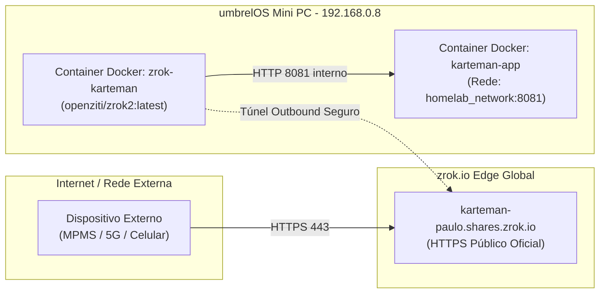

# Acesso Remoto Externo com zrok v2 (Zero-Trust & Custo Zero)

Este documento descreve a implementação, arquitetura e manutenção do túnel público seguro com o **zrok v2**, permitindo acesso a serviços internos do homelab (como o **Karteman**) a partir de qualquer rede externa ou corporativa com restrições severas de firewall (como o Fortinet do MPMS), com **custo zero** e **URL HTTPS pública e fixa**.

---

## 1. Por que zrok v2?

- **Custo Zero Real (R$ 0,00):** Sem necessidade de comprar ou renovar domínio próprio (`.com.br`, `.xyz`, etc.).
- **URL Fixa e Reservada:** O zrok v2 permite reservar um nome exclusivo (ex: `https://karteman-paulo.shares.zrok.io`), que não expira nem muda aleatoriamente após reboots.
- **Bypass de Firewalls Corporativos:** Como a conexão de saída é iniciada de dentro do homelab via TLS/HTTPS padrão (Porta 443), ela contorna bloqueios de portas e protocolos UDP/WireGuard (Tailscale).
- **Certificado SSL Válido Internacionalmente:** O tráfego HTTPS é assinado publicamente pela autoridade certificadora do `*.shares.zrok.io`, abrindo perfeitamente em qualquer navegador sem necessidade de instalar certificados adicionais.

---

## 2. Topologia e Arquitetura no Homelab



---

## 3. Configuração e Persistência no umbrelOS

O umbrelOS possui raiz imutável via Rugix. Por esse motivo, todos os dados de autenticação e identidade do zrok são armazenados na partição persistente:

- **Diretório Persistente de Identidade:** `/data/zrok/.zrok2`
- **Volume montado no container:** `/data/zrok/.zrok2 -> /home/ziggy/.zrok2`
- **Variáveis de Ambiente:** Centralizadas em `config.env` (e `/data/config.env`):
  ```bash
  ZROK_ENABLE_TOKEN="<seu_token_aqui>"
  ZROK_UNIQUE_NAME="karteman-paulo"
  ```

---

## 4. Declaração no Docker Compose e Blindagem Contra Rate Limit (HTTP 429)

Os 6 túneis essenciais estão organizados de forma dedicada na stack `compose/tunnels/docker-compose.yml`, conectando-se diretamente à bridge `homelab_network`.

### Resiliência contra Queda de Luz, Reboots e Rate Limits:
A API pública do zrok (`api-v2.zrok.io`) aplica um rate limit rígido quando múltiplos túneis do mesmo ambiente tentam se conectar simultaneamente. Para garantir **100% de autonomia e resiliência** em reinicializações do servidor ou atualizações de containers:
1. **Escalonamento Progressivo (Staggered Startup):** Cada container executa um `sleep` incremental em seu entrypoint antes de invocar o `zrok2 share`.
2. **Backoff Controlado (`restart: on-failure:5`):** Substituiu o looping infinito do `restart: unless-stopped`, evitando que falhas temporárias de rede interna congelem o ambiente em listas de bloqueio por HTTP 429.

```yaml
services:
  # 1. Painel Principal umbrelOS (imediato)
  zrok-umbrel:
    image: openziti/zrok2:latest
    container_name: zrok-umbrel
    restart: on-failure:5
    user: "1000:1000"
    entrypoint: ["/bin/sh", "-c"]
    command:
      - |
        echo "zrok-umbrel iniciando...";
        exec zrok2 share public http://172.18.0.1:80 -n public:umbrel-paulo --headless
    volumes:
      - /data/zrok/.zrok2:/home/ziggy/.zrok2

  # 2. Plataforma Clínica Karteman (aguarda 20s)
  zrok-karteman:
    image: openziti/zrok2:latest
    container_name: zrok-karteman
    restart: on-failure:5
    user: "1000:1000"
    entrypoint: ["/bin/sh", "-c"]
    command:
      - |
        sleep 20;
        echo "zrok-karteman iniciando...";
        exec zrok2 share public http://karteman-app:8081 -n public:karteman-paulo --headless
    volumes:
      - /data/zrok/.zrok2:/home/ziggy/.zrok2

  # 3. Robô Verifica Diários Oficiais (aguarda 40s)
  zrok-diarios:
    image: openziti/zrok2:latest
    container_name: zrok-diarios
    restart: on-failure:5
    user: "1000:1000"
    entrypoint: ["/bin/sh", "-c"]
    command:
      - |
        sleep 40;
        echo "zrok-diarios iniciando...";
        exec zrok2 share public http://verifica-diarios-app:8093 -n public:diarios-paulo --basic-auth "${SAMBA_USER_1:-paulo}:${SYSTEM_PASSWORD}" --basic-auth "${SAMBA_USER_2:-kamila}:${KAMILA_PASSWORD}" --headless
    volumes:
      - /data/zrok/.zrok2:/home/ziggy/.zrok2

  # 4. App Investimentos Pessoais (aguarda 60s)
  zrok-investimentos:
    image: openziti/zrok2:latest
    container_name: zrok-investimentos
    restart: on-failure:5
    user: "1000:1000"
    entrypoint: ["/bin/sh", "-c"]
    command:
      - |
        sleep 60;
        echo "zrok-investimentos iniciando...";
        exec zrok2 share public http://paulo-investimentos-app:8094 -n public:investimentos-paulo --basic-auth "${SAMBA_USER_1:-paulo}:${SYSTEM_PASSWORD}" --basic-auth "${SAMBA_USER_2:-kamila}:${KAMILA_PASSWORD}" --headless
    volumes:
      - /data/zrok/.zrok2:/home/ziggy/.zrok2

  # 5. Nextcloud (aguarda 80s)
  zrok-cloud:
    image: openziti/zrok2:latest
    container_name: zrok-cloud
    restart: on-failure:5
    user: "1000:1000"
    entrypoint: ["/bin/sh", "-c"]
    command:
      - |
        sleep 80;
        echo "zrok-cloud iniciando...";
        exec zrok2 share public http://172.18.0.1:8081 -n public:cloud-paulo --headless
    volumes:
      - /data/zrok/.zrok2:/home/ziggy/.zrok2

  # 6. Jellyfin (aguarda 100s)
  zrok-jellyfin:
    image: openziti/zrok2:latest
    container_name: zrok-jellyfin
    restart: on-failure:5
    user: "1000:1000"
    entrypoint: ["/bin/sh", "-c"]
    command:
      - |
        sleep 100;
        echo "zrok-jellyfin iniciando...";
        exec zrok2 share public http://172.18.0.1:8096 -n public:jellyfin-paulo --headless
    volumes:
      - /data/zrok/.zrok2:/home/ziggy/.zrok2
```

O script `homelab-daemon.sh` garante que a stack `compose/tunnels` inicie automaticamente em qualquer reinicialização do sistema. Também está disponível o script utilitário `scripts/utils/start_zrok_tunnels.sh` para acionamentos manuais escalonados.

---

## 5. URLs de Acesso Ativas

| Serviço | URL Pública Externa (zrok) | Apontamento Interno | Autenticação / Proteção |
| :--- | :--- | :--- | :--- |
| 🖥️ **Painel umbrelOS** | [https://umbrel-paulo.shares.zrok.io](https://umbrel-paulo.shares.zrok.io) | `http://172.18.0.1:80` | Senha Mestre do Umbrel |
| 🩺 **Clínica Karteman** | [https://karteman-paulo.shares.zrok.io](https://karteman-paulo.shares.zrok.io) | `http://karteman-app:8081` | Login da Aplicação Karteman |
| 🍿 **Jellyfin (Streaming/TV)** | [https://jellyfin-paulo.shares.zrok.io](https://jellyfin-paulo.shares.zrok.io) | `http://172.18.0.1:8096` | Login Oficial do Jellyfin |
| 📰 **Verifica Diários** | [https://diarios-paulo.shares.zrok.io](https://diarios-paulo.shares.zrok.io) | `http://verifica-diarios-app:8093` | 🔒 Usuário/Senha (`paulo` / `kamila`) |
| 💰 **Investimentos** | [https://investimentos-paulo.shares.zrok.io](https://investimentos-paulo.shares.zrok.io) | `http://paulo-investimentos-app:8094` | 🔒 Usuário/Senha (`paulo` / `kamila`) |
| ☁️ **Nextcloud** | [https://cloud-paulo.shares.zrok.io](https://cloud-paulo.shares.zrok.io) | `http://172.18.0.1:8081` | Login Nextcloud |


